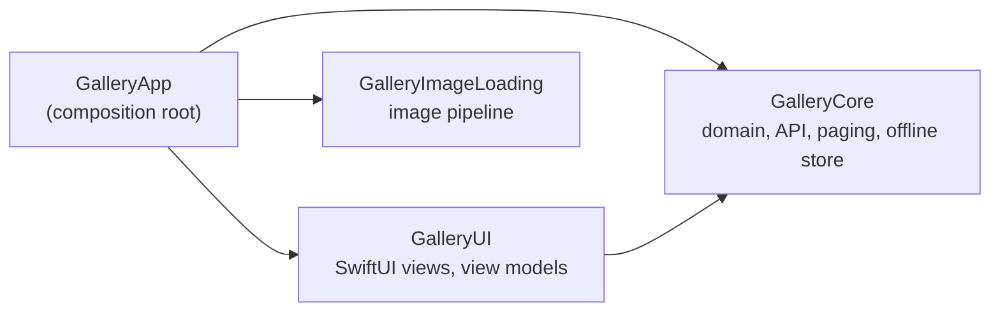

# Gallery

## Overview

An Unsplash photo browser in SwiftUI for iOS 17+, on iPhone and iPad:

- **Grid**: Editorial photos in square cells (2 columns compact, 3 regular), each with its caption (alt description → description → "Untitled photo") and endless scroll.
- **Search**: the same grid and endless scroll for a query, cross-fading over the feed, which keeps its scroll position underneath.
- **Full screen**: opens with a zoom from the cell on iOS 18+ (standard push on iOS 17). Pinch and double-tap zoom, pan, drag down or Close to return, Photographer credit with Unsplash referral links.
- **Own image pipeline**: memory and disk caches, in-flight dedup, prefetch and cancellation, downsampling off the main thread, BlurHash placeholders, and a rendition sized to each cell and each screen.
- **Offline feed**: the last ~300 feed photos are saved and shown, with a banner, when the network fails.
- **States**: skeleton, paging footer with retry, full-screen errors, a friendly rate-limit message, invalid access key, empty search, pull to refresh, Dynamic Type, VoiceOver, Reduce Motion, dark mode.

## Setup

Requirements: Xcode 16 or later, iOS 17 or later.

1. Create an Unsplash app at <https://unsplash.com/oauth/applications> and copy its **Access Key**.
2. Create the local secrets file, which is gitignored:
   ```sh
   cp Config/Secrets.example.xcconfig Config/Secrets.xcconfig
   ```
3. Replace `your-unsplash-access-key` in `Config/Secrets.xcconfig` with your key, without quotes: xcconfig keeps quotes as part of the value, and Unsplash then rejects the key with a 401.
4. Open `Gallery.xcodeproj` and run the `GalleryApp` scheme.

No key? Add `-useStubs` to the scheme's launch arguments to run on bundled fixtures (feed, the "cats" search, images). `-stubOffline` adds a simulated offline network.

Run the logic tests without a simulator:

```sh
cd Gallery && swift test
```

## Architecture



Three SPM modules and an app target. **GalleryCore** (Foundation only) holds the domain (`Photo`, `PhotoStream`, `Paginated`), the Unsplash endpoints, mappers and renditions, the HTTP client and the Offline feed store. **GalleryImageLoading** (Foundation, ImageIO, CoreGraphics) is the image pipeline and knows nothing about photos or Unsplash. **GalleryUI** depends only on Core and receives everything else as closures. Only the composition root (`App/GalleryApp.swift`, `App/ImagePipeline.swift`) sees all three and wires concrete types together. Core and ImageLoading also build for macOS, so `swift test` runs their tests in about a second (ADR 0002).

**Image pipeline**: decorators around one protocol, outermost first. The UI only sees `PhotoImages` closures.

```mermaid
classDiagram
  direction LR
  class PhotoImages {
    +preview()
    +cachedImage()
    +image()
    +fullScreenImage()
    +prefetch()
  }
  <<protocol>> ImageLoader
  <<protocol>> ImageDataLoader
  <<protocol>> ImageDataStore
  ImagePipeline ..> PhotoImages : builds closures
  ImagePipeline --> MemoryCachingImageLoader
  ImagePipeline --> ImagePrefetcher
  ImagePipeline --> PreviewCache
  ImageLoader <|.. MemoryCachingImageLoader
  ImageLoader <|.. DownsamplingImageLoader
  MemoryCachingImageLoader --> DownsamplingImageLoader : decoratee
  ImagePrefetcher --> MemoryCachingImageLoader
  DownsamplingImageLoader --> DiskCachingImageDataLoader
  ImageDataLoader <|.. DiskCachingImageDataLoader
  ImageDataLoader <|.. InFlightDedupImageDataLoader
  ImageDataLoader <|.. RemoteImageDataLoader
  DiskCachingImageDataLoader --> InFlightDedupImageDataLoader : decoratee
  DiskCachingImageDataLoader --> ImageDataStore
  ImageDataStore <|.. FileImageDataStore
  InFlightDedupImageDataLoader --> RemoteImageDataLoader : decoratee
```

**Feed, search and offline**: the view model depends on closures, not on Core types, and the composition root builds them.

```mermaid
classDiagram
  direction LR
  class GalleryViewModel {
    +loadFeed()
    +loadOfflineFeed()
    +search(query)
  }
  <<protocol>> FeedStore
  <<protocol>> HTTPClient
  GalleryViewModel --> StreamPager
  CompositionRoot ..> GalleryViewModel : injects closures
  CompositionRoot ..> OfflineFeed : saving(loadFeed, store)
  CompositionRoot ..> PhotoStream : feed and per-Query search
  PhotoStream ..> UnsplashEndpoint
  PhotoStream ..> EditorialPhotosMapper
  PhotoStream ..> SearchPhotosMapper
  OfflineFeed ..> FeedStore
  FeedStore <|.. CodableFeedStore
  HTTPClient <|.. AuthorizingHTTPClient
  HTTPClient <|.. URLSessionHTTPClient
  AuthorizingHTTPClient --> URLSessionHTTPClient : decoratee
```

Arrows follow the dependency-diagram notation: `<|..` conforms, `-->` has a (strong, injected), `..>` uses. Closure dependencies are drawn as "uses" with a label, because the code injects closures at these seams.

- **Boundaries by closure.** `GalleryViewModel` takes `loadFeed`, `loadOfflineFeed` and `search` closures, and views take `PhotoImages`. UI tests and previews swap them freely, and the UI never sees URLs, caches or Unsplash.
- **Mappers only translate.** `PhotoStream` owns every paging rule: stop on `total_pages` or an empty page, drop duplicate ids. Mappers turn a response into a `PhotoPage` or a typed error (rate limited, invalid key, invalid data).
- **Decorators, not a god object.** Memory cache → downsampling → disk cache → dedup → network, each one small and unit tested on its own (ADR 0001, 0006).
- **Styles in one place.** Spacing, hit target, scrim and control opacities, fade timings, the banner chip and the caption scrim live in `GalleryUI/DesignSystem/`. They move into their own module once a second feature or app needs them; with one feature, a module would be speculative.
- **Storage models separate from the domain.** `Photo` is not `Codable`. The Offline feed saves private `Local*` mirrors in a versioned JSON file (ADR 0004).

## Technical choices

| Decision | Why | Record |
|---|---|---|
| Own image pipeline, no library | The brief rewards it, and each layer (cache, dedup, prefetch, downsampling) can be measured in Instruments | ADR 0001 |
| SPM modules, logic also on macOS | Enforced boundaries; logic tests run in `swift test` with no simulator | ADR 0002 |
| Search on submit, not as you type | 50 requests/hour: typing "mountain" would spend 8 | ADR 0003 |
| Offline feed: JSON file, network first, no expiry | A few hundred records read and written whole; shown only when the alternative is an empty screen | ADR 0004 |
| Fixed square cells in `LazyVGrid` | Known pixel size per cell, so each rendition is requested at exactly that size | ADR 0005 |
| In-flight dedup with per-caller cancellation | A cancelled prefetch must not cancel the visible cell's shared load | ADR 0006 |
| Renditions sized from `raw` (`w`, `dpr`, `q`, `fm=jpg`), keeping the URL's existing query items | `regular` (1080 px) is too soft on large phones and iPads and too big for small cells | decision log, M3/M5 |
| One request in flight per Stream; a new Query, Cancel or refresh cancels the old request | Every request counts against the hourly budget | decision log, review fixes and M8 |

Every decision, big or small, is listed in [`docs/decision-log.md`](docs/decision-log.md).

## Performance

- **Right-sized images**: each cell asks for its exact pixel size (`w` × `dpr`), decoded with ImageIO downsampling off the main thread. Full screen asks for the screen's fitted size. Very tall portraits are cropped at 3:1 by the CDN, so they fill the cell sharply with bounded memory.
- **Caches**: decoded images in an `NSCache` limited to about 100 MB by pixel cost and cleared on memory warning. Raw bytes on disk, about 200 MB with LRU eviction in the background at launch. BlurHash placeholders decoded at 32 × 32 and cached by hash.
- **No duplicated work**: one in-flight request per URL, shared by every caller (cell, prefetch, full screen). Prefetch covers the next 9 photos. Cancelling a prefetch never cancels a visible cell.
- **Minimal SwiftUI updates**: `@Observable` models scoped per cell. Images already in memory show on the first frame, with no placeholder or fade. The full-screen overlay is kept out of per-frame gesture updates.

Instruments, on device after scrolling about 500 images (to fill in):

| Instrument | Result |
|---|---|
| Time Profiler (scroll) | _TODO: hitches, main-thread time_ |
| Allocations (scroll ~500, open/close ~20 full screen) | _TODO: steady-state memory_ |
| SwiftUI (body updates while scrolling) | _TODO_ |

## Testing

- **244 unit tests** in Swift Testing, in three targets: Core 67, ImageLoading 50, UI 127, including 14 snapshot tests of the cell and the empty and error states in light and dark. Every class under test goes through `makeSUT` with leak tracking. Logic was built test first, one test at a time.
- **4 XCUITests**, one per user journey: browse and page the feed, search and clear back to the feed, open a photo full screen and close it, launch offline with a saved feed. They run on bundled fixtures (`-useStubs`), with no network and no key.
- **CI** runs `swift test`, then the UI tests on a simulator.

## Trade-offs and improvements

- **The client-side key ships in the app bundle.** That's fine for a demo; production would put a server proxy in front of Unsplash.
- **iOS 17 gets a standard push**, not the zoom transition: `NavigationStack` has no zoom on iOS 17, and faking one would mean presenting over the stack.
- **The Offline banner hides on the next successful load**, not when the network comes back (no reachability monitoring).
- **Snapshot tests render on macOS**: they guard layout, not exact iOS pixels.
- **Not built**: swiping between photos in full screen, a sharper rendition when zoomed past 1×, translations (the String Catalog is English only).

## AI usage

Built with Claude Code as a pair. The whole trail is in the repo:

- [`.scratch/`](.scratch/): `roadmap.md`, then one folder per milestone with its spec and tickets, including review notes and every deviation an agent made.
- [`docs/decision-log.md`](docs/decision-log.md) and [`docs/adr/`](docs/adr/): every decision as it was made.

How it was used: grilling the plan into a domain glossary (`CONTEXT.md`), ADRs and milestone specs; agents implementing tickets test first, one test at a time, later two milestones in parallel git worktrees; and review passes (standards, spec, security, SwiftUI performance) whose fixes are separate commits. I reviewed and verified every agent batch (tests, lint, authorship) before merging. Device checks, Instruments and the final review are mine.

## Time log

_TODO_
